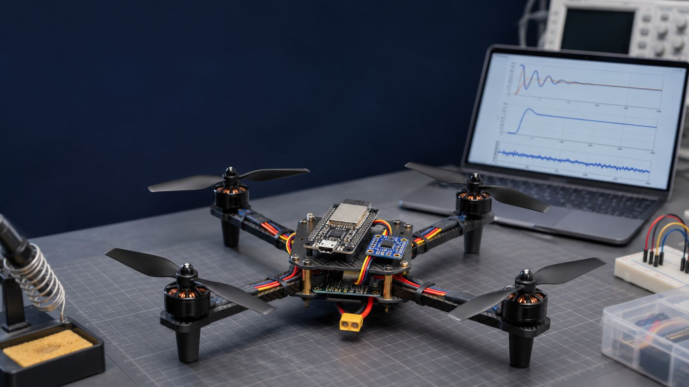
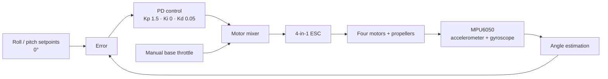
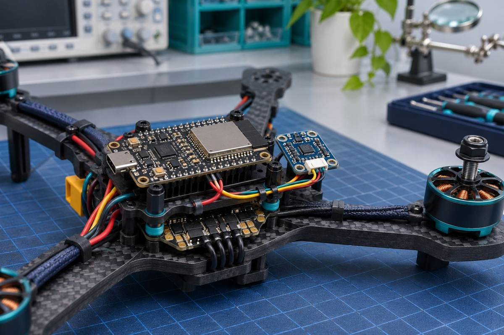

# CSE Drone Project

### ESP32-Based Quadcopter Attitude Stabilization

**IE3034 · Control System Engineering · Group 01**

An engineering prototype exploring feedback control for roll and pitch stabilization.

> **Visual note:** The photographs in this README are AI-generated concept visuals. They illustrate the project architecture and are not photographs of the team's physical prototype or experimental evidence.

## At a glance

| Platform | Control focus | Current evidence |
| --- | --- | --- |
| ESP32, MPU6050, four brushless motors and a 4-in-1 ESC | Roll and pitch stabilization with PD settings | Normalized Simulink responses; physical performance still requires measured logs |

**Quick links:** [Architecture](#control-architecture) · [Hardware](#hardware-and-control-path) · [Model](#model-and-simulation) · [Implementation status](#implementation-status-and-discrepancies) · [Verification plan](#next-verification-steps)

## Control architecture

The diagram reflects the documented roll/pitch path. Automatic height control is described as a goal in the report but is stated as unimplemented in Section 6.

  
   
  Concept visualization of the electronics layout; not a photo of the built prototype.

## Hardware and control path

The ESP32 reads an MPU6050 accelerometer and gyroscope, estimates roll and pitch, applies controller corrections, mixes four motor commands, and sends them through a 4-in-1 ESC to four brushless motors. A Wi-Fi dashboard and OLED support monitoring. A downward ultrasonic sensor is proposed for height measurement.

| Item | Reported detail |
| --- | --- |
| Roll and pitch setpoints | 0 degrees |
| Roll and pitch gains | Kp 1.5, Ki 0, Kd 0.05 (PD control) |
| Controller update | Nominal 10 ms |
| Mass | 0.350 kg |
| ESC signal pins | M1 GPIO25, M2 GPIO26, M3 GPIO27, M4 GPIO14 |
| MPU6050 and OLED I2C | SDA GPIO21, SCL GPIO22 |

At 0.350 kg, ideal level hover requires about 3.43 N total vertical thrust, or 0.86 N per motor if evenly shared. Real motor response and control margin must be measured.

## Model and simulation

The report uses a small-angle rigid-body model: `I_x * phi_ddot = tau_roll` and `I_y * theta_ddot = tau_pitch`. With local command-to-torque gain `K_tau`, the approximate command-to-angle plant is `K_tau / (I * s^2)`. Inertia and actuator gains were not identified; Simulink uses normalized plant gain 1. Its damped roll/pitch response illustrates the controller in that simplified model and does not validate physical flight performance.

## Implementation status and discrepancies

- **Altitude hold:** The introduction and architecture describe an altitude PID, but Section 6 explicitly says base throttle is manual and automatic height control is not implemented. Treat it as proposed until verified in firmware and tests.
- **Motor numbering:** Section 5.2 says M1 front right, M2 rear right, M3 front left, M4 rear left. Section 7.3 says M1 front left, M2 front right, M3 rear left, M4 rear right. Verify the physical motor map and mixer signs before powered tests.
- **Gains and internal behavior:** The report says to confirm final gains, controller equations, and saturation/anti-windup behavior from `control_core.h`; that source was not supplied here.
- **Evidence:** The report contains normalized simulations and dashboard material, but no measured flight-response dataset or validated altitude-hold result.
- **Scope:** Yaw and horizontal position hold are not implemented.

## Next verification steps

1. Check motor order, rotation and mixer correction direction with propellers removed.
2. Confirm MPU6050 mounting orientation, calibration, filtering, and units.
3. Confirm the ultrasonic sensor model, operating range, trigger/echo pins, and echo voltage. ESP32 GPIO tolerance is 3.6 V.
4. Log timestamped setpoints, roll/pitch estimates, motor commands and battery voltage to measure overshoot, settling and disturbance recovery.
5. Identify actuator gains and hover thrust before comparing simulation with physical results.

## Sources

- Group assignment PDF: `IE3034CSE_Group_no_01.pdf` (source document, not included in this repository).
- [PX4 multicopter control architecture](https://docs.px4.io/main/en/flight_stack/controller_diagrams)
- [PX4 multicopter PID tuning](https://docs.px4.io/main/en/config_mc/pid_tuning_guide_multicopter)
- [TDK MPU-6000/MPU-6050 specification](https://invensense.tdk.com/wp-www.invensense.com/wp-content/uploads/2015/02/MPU-6000-Datasheet1.pdf)
- [Espressif GPIO voltage guidance](https://docs.espressif.com/projects/esp-faq/en/latest/esp-faq-en-master.pdf)
- [ArduPilot rangefinder setup](https://ardupilot.org/copter/docs/common-rangefinder-setup.html)
- [ArduPilot ESC and motor checks](https://shop.ardupilot.org/copter/docs/connect-escs-and-motors.html)
