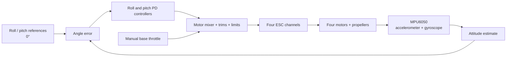
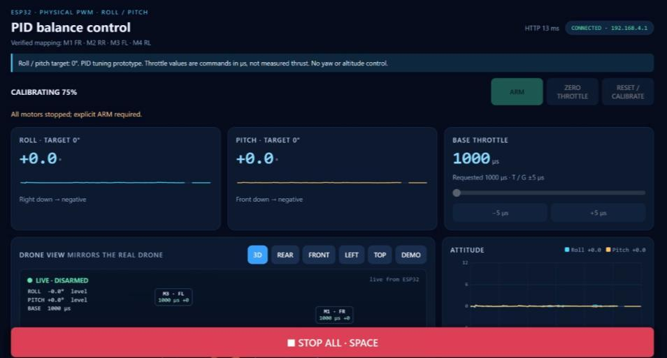
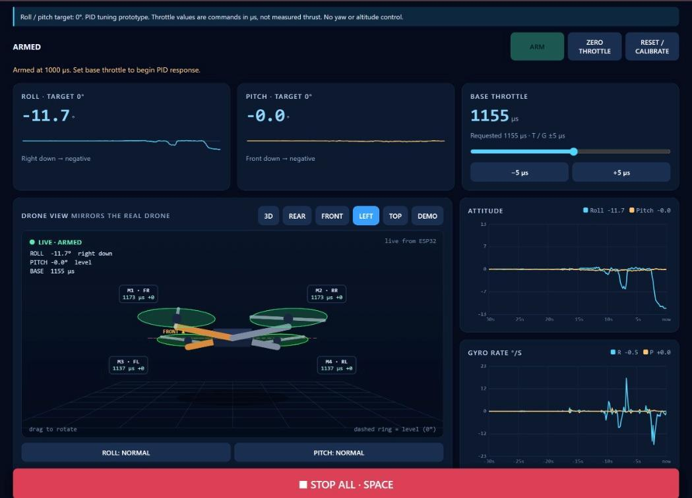

<div align="center">

# CSE Drone Project

### Feedback control for a quadcopter prototype

**IE3034 · Control System Engineering · Group 01 · 2026**

A physical ESP32-based quadcopter and a normalized MATLAB/Simulink study of roll and pitch stabilization.

</div>

## Watch the project demo

Play the 44-second demonstration below, directly on this repository page.

| &emsp;&emsp;&emsp; | Project demonstration | &emsp;&emsp;&emsp; |
| :---: | :---: | :---: |
| &emsp;&emsp;&emsp; | https://github.com/user-attachments/assets/06ee024c-3a24-49d9-be64-d7df85800d6f | &emsp;&emsp;&emsp; |

Actual prototype footage · English technical narration · Original background song removed

[Subtitles](media/captions.srt) · [Transcript and scene guide](docs/video-guide.md)

The video shows the OLED state, Wi-Fi motor controls and response plots, and a powered prototype test. Its original end card says “Drone Hover Test”; the visible footage and report do not provide a measured free-flight validation of stable hover. The narration makes that distinction explicit.

<p align="center">
  
  
</p>

<p align="center"><sub>Actual prototype photographs reproduced from the group report (PDF page 22).</sub></p>

> **Project status:** The supplied report documents a physical prototype and Wi-Fi tuning dashboard, plus simulated roll/pitch responses. It states that automatic altitude control is **not implemented** in Section 6, despite describing an altitude loop as a project objective elsewhere. No measured free-flight performance is claimed here.

## Contents

- [Watch the project demo](#watch-the-project-demo)
- [What the system does](#what-the-system-does)
- [Control architecture](#control-architecture)
- [Hardware and connections](#hardware-and-connections)
- [Mathematical model](#mathematical-model)
- [Controller and motor mixing](#controller-and-motor-mixing)
- [Simulation and experimental evidence](#simulation-and-experimental-evidence)
- [Known gaps and verification plan](#known-gaps-and-verification-plan)
- [Repository contents](#repository-contents)
- [References](#references)

## What the system does

The controller targets **zero roll and zero pitch** so the airframe stays approximately level. An MPU6050 supplies angular-rate and acceleration measurements; the ESP32 estimates attitude, calculates roll and pitch corrections, combines them with a manually selected base throttle, and sends four commands to a 4-in-1 electronic speed controller (ESC). The ESC powers four brushless motors. A Wi-Fi dashboard supports monitoring and gain adjustment; an OLED provides local status.

The report proposes a downward-facing ultrasonic sensor and altitude PID loop, but the implemented controller described in Section 6 uses manual base throttle. Yaw control and horizontal position hold are outside the documented implementation.

## Control architecture



The loops share the same four motors, so a mixer translates common thrust and differential roll/pitch corrections into individual motor commands. The diagram describes the reported control flow; the final source code is needed to confirm exact filtering, controller formula, limits, and mixer signs.

## Hardware and connections

| Component | Quantity | Function |
| --- | ---: | --- |
| ESP32 development board | 1 | Reads sensors, runs the control loop, drives ESC signals and hosts the Wi-Fi interface |
| MPU6050 module | 1 | Measures three-axis angular rate and acceleration for attitude estimation |
| Brushless motors and propellers | 4 each | Generate thrust |
| 4-in-1 ESC | 1 | Converts four control signals into three-phase motor drive |
| Ultrasonic range sensor | 1 proposed | Measures distance to the surface below; altitude-loop implementation is unconfirmed |
| OLED display | 1 | Local monitoring |
| Battery | 1 | Propulsion power; controller and sensors require suitable regulated power |

### Documented pin map

| Interface | ESP32 pins | Notes |
| --- | --- | --- |
| ESC channel signals M1–M4 | GPIO25, GPIO26, GPIO27, GPIO14 | Physical motor positions disagree between report sections; verify before running motors |
| MPU6050 I²C | SDA GPIO21, SCL GPIO22 | Report specifies 3.3 V and GND |
| OLED I²C | SDA GPIO21, SCL GPIO22 | Shares the I²C bus; verify each module's address |
| Ultrasonic trigger/echo | Not specified | Confirm sensor model, GPIO selection and echo voltage before wiring |
| ESC signal ground | GND | Common signal reference with ESP32 |

**Power and interface checks.** Motors draw power through the ESC, not through an ESP32 GPIO. The report calls for a regulated controller/sensor supply and a common ESP32–ESC signal ground. Espressif states ESP32 GPIO tolerance is 3.6 V; a sensor with a 5 V echo output needs an appropriate interface before its echo pin is connected. Confirm the actual ESC protocol and signal pulse timing from the firmware and ESC documentation.

## Mathematical model

The report assumes a rigid, approximately symmetric airframe, small roll and pitch angles, and independent axes around a chosen operating point. Motor lag, aerodynamic damping, yaw coupling and sensor delay are omitted from the basic plant.

Let `φ` be roll, `θ` pitch, `Iₓ` and `Iᵧ` the respective inertias, and `τφ` and `τθ` the net torques. The simplified rotational equations are

```text
Iₓ φ̈ = τφ + disturbance_roll
Iᵧ θ̈ = τθ + disturbance_pitch
```

For a symmetric X frame, the roll torque depends on the left–right thrust difference and pitch torque on the front–rear difference. If the center-to-motor arm length is `ℓ` and arms are at 45°, each perpendicular lever arm is `d = ℓ / √2`. The exact signs depend on the chosen body axes and physical motor numbering.

With a locally linear command-to-torque factor `Kτ`, zero initial conditions, and disturbances set to zero, either axis has the approximate plant

```text
angle(s) / command(s) = Kτ / (I s²)
```

This is an ideal double integrator. Actual `I` and `Kτ` have not been identified, so this formula is a modeling starting point rather than a calibrated prediction. The report's mass is **0.350 kg**. Ideal level hover therefore requires about **3.43 N total vertical thrust**, or **0.86 N per motor** if all four share it equally. The estimate excludes control margin, tilt, propulsion differences and battery effects.

## Controller and motor mixing

The reported settings are the same for roll and pitch:

| Axis | Setpoint | Kp | Ki | Kd |
| --- | ---: | ---: | ---: | ---: |
| Roll | 0° | 1.5 | 0 | 0.05 |
| Pitch | 0° | 1.5 | 0 | 0.05 |

Because `Ki = 0`, these settings describe **PD control within a PID structure**. The report gives a nominal **10 ms** update interval and says actual elapsed time is measured. The exact firmware equation and units must be checked in `control_core.h`; gain numbers cannot be transferred between degree/radian or discrete/continuous implementations without accounting for those choices.

Conceptually, a motor command is `base throttle + roll correction + pitch correction + motor trim`, followed by output limits. Roll correction changes left versus right thrust; pitch correction changes front versus rear thrust. The report says saturation is detected and a zero time increment is passed to the controller to freeze integral accumulation. With `Ki = 0`, that behavior has no integral effect in the reported setting; it must still be verified in firmware before integral control is enabled.

**Motor-map conflict:** Section 5.2 assigns M1 front right, M2 rear right, M3 front left, M4 rear left. Section 7.3 assigns M1 front left, M2 front right, M3 rear left, M4 rear right. The wiring table only fixes GPIO-to-ESC-channel numbering. The physical positions and mixer signs remain unresolved.

## Simulation and experimental evidence

The MATLAB/Simulink model uses an initial 5° attitude error, 0° reference, `Kp = 1.5`, `Kd = 0.05`, and a **normalized plant gain of 1**. The report shows underdamped responses approaching zero, and compares proportional gains 0.75, 1.5 and 3.0 while holding derivative gain fixed. These plots are **simulation results**, not measured flight responses.


<p align="center"><sub>Simulink roll comparison from the report; normalized plant parameters.</sub></p>

The actual Wi-Fi interface shown in the report displays roll/pitch telemetry and controls for gains and motor commands:

<p align="center">
  
  
</p>

<p align="center"><sub>Dashboard screenshots reproduced from the group report. They show the interface and sample displayed traces; they are not a validated flight-performance dataset.</sub></p>

A meaningful physical comparison needs timestamped setpoint, estimated angle, angular rate, command saturation, individual motor commands, battery voltage, and test conditions. Report rise time, overshoot, settling time, steady-state error and disturbance recovery only from those measurements. The prototype photos show a test stand; its friction and constraints can change the dynamics relative to the free-body model.

## Known gaps and verification plan

1. **Confirm the final firmware:** controller implementation, actual gains, time-step handling, filter design, arming conditions, output limits and ESC signal format.
2. **Resolve the motor map:** check each ESC channel, motor location, rotation direction and mixer correction sign with propellers removed.
3. **Validate attitude estimation:** verify MPU6050 axis orientation, gyro bias calibration, units and filtering. Accelerometer tilt estimates are affected by linear acceleration; integrating gyro rate accumulates bias, so sensor fusion matters.
4. **Measure the plant:** weigh the final assembly, estimate inertias and measure thrust against command near hover. Then compare the identified model with the normalized simulation.
5. **Log repeatable tests:** separate restrained-test data from free-flight data and state the test conditions.
6. **Treat height hold as future work until proven:** document the ultrasonic sensor model, valid range, tilt compensation, out-of-range behavior and a tested altitude loop before claiming automatic height control.
7. **Expand control scope explicitly:** yaw stabilization and horizontal position hold need additional feedback/control and are not demonstrated by roll/pitch balancing alone.

## Repository contents

| Location | Contents |
| --- | --- |
| [`media/`](media/) | Subtitle sidecar; the demonstration plays inline above |
| [`docs/video-guide.md`](docs/video-guide.md) | Video transcript, scene map, and technical context |
| [`assets/`](assets/) | Prototype photos, dashboard screenshots, and simulation figure extracted from the group report |

The final firmware, raw test logs, and the assignment PDF are not currently included. Documentation distinguishes reported settings, simulated results, and observed prototype footage from validated physical performance.

## References

- Group assignment: `IE3034CSE_Group_no_01.pdf` (source of the prototype photos, dashboard screenshots, reported values and simulation; PDF not currently stored in this repository).
- [PX4 multicopter control architecture](https://docs.px4.io/main/en/flight_stack/controller_diagrams)
- [PX4 multicopter PID tuning guide](https://docs.px4.io/main/en/config_mc/pid_tuning_guide_multicopter)
- [TDK MPU-6000/MPU-6050 product specification](https://invensense.tdk.com/wp-www.invensense.com/wp-content/uploads/2015/02/MPU-6000-Datasheet1.pdf)
- [Espressif ESP32 GPIO voltage guidance](https://docs.espressif.com/projects/esp-faq/en/latest/esp-faq-en-master.pdf)
- [ArduPilot rangefinder setup](https://ardupilot.org/copter/docs/common-rangefinder-setup.html)
- [ArduPilot motor and ESC checks](https://shop.ardupilot.org/copter/docs/connect-escs-and-motors.html)
