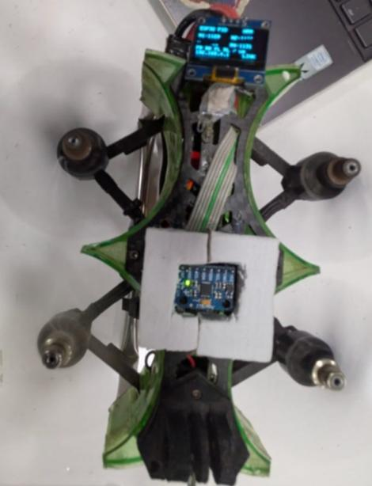
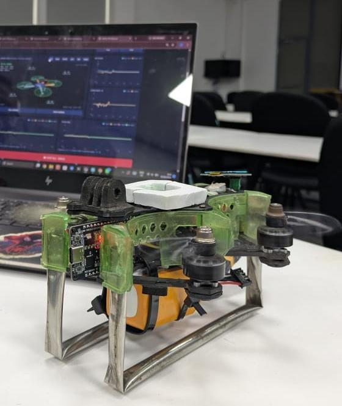
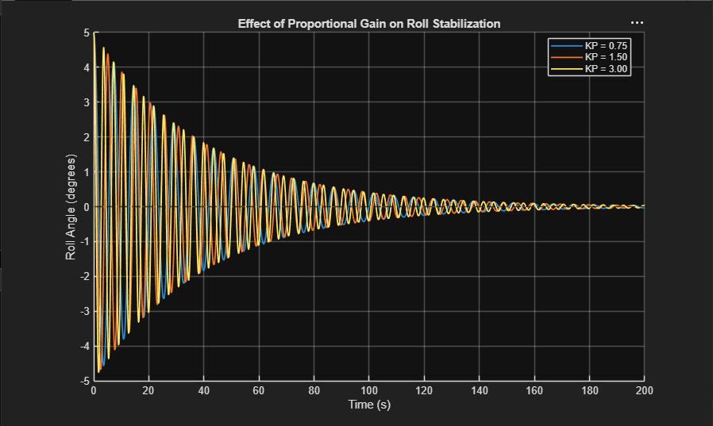

# CSE Drone Project

**IE3034 Control Systems Engineering | Four-member group project | 2026**

An ESP32-based quadcopter prototype for roll and pitch stabilization, with an MPU6050 IMU, four brushless motors, a 4-in-1 ESC, an OLED status display, and a Wi-Fi tuning dashboard. The team first tested a small-frame coreless-motor prototype, then built the larger brushless version.

## Demonstration

[Watch the project video](https://github.com/user-attachments/assets/06ee024c-3a24-49d9-be64-d7df85800d6f). The footage shows the prototype and powered testing. It does not provide a measured free-flight stability dataset.

 

## Implemented control

- ESP32 Arduino C++ firmware reads the MPU6050 over I²C and calibrates roll/pitch offsets and gyro bias while the frame is still.
- A complementary filter combines accelerometer angles and gyro rates. The target is level roll and pitch.
- Separate roll and pitch PID structures calculate corrections, then a four-motor mixer adds them to manual base throttle and per-motor trims.
- The controller targets a 100 Hz sample interval. The ESC outputs use 50 Hz PWM. Actual loop timing can vary because sensing, OLED updates and HTTP handling share the main loop.
- Default gains for both axes are `Kp=1.5`, `Ki=0`, `Kd=0.05`. The integral path and bounded anti-windup logic exist in source, but integral action is disabled at the default setting. These defaults are not documented flight-tuned gains.
- The firmware includes calibration, arming checks, stop/fault handling, and Wi-Fi heartbeat disarming. See [firmware README](firmware/README.txt) for setup, pin mapping, limits, and behavior.

**Scope:** This is a roll/pitch tuning prototype. Automatic altitude control, yaw control, position hold and autonomous takeoff are not implemented. A downward-facing ultrasonic sensor was considered for altitude control but was not included in the final build.

## Hardware

| Component | Purpose |
| --- | --- |
| ESP32 Dev Module | Sensor reading, controller, PWM outputs, Wi-Fi dashboard |
| MPU6050 | Acceleration and angular-rate measurements |
| Four brushless motors and 4-in-1 ESC | Propulsion and differential thrust |
| SSD1306 OLED | Local attitude and output status |

The final firmware maps GPIO25/26/27/14 to front-right/rear-right/front-left/rear-left ESC channels. Check physical wiring and motor rotation before powered use.

## Evidence and limitations

The project report contains Simulink roll/pitch response plots, prototype photos and dashboard screenshots. The simulation uses a simplified normalized plant and does not measure free-flight performance. The team reports staged motor, hover and flight testing and iterative tuning; the available repository media does not establish quantified free-flight stability or repeatable flight-test metrics. The repository owner confirmed that the firmware in this package was the version used for the team's final tests. The package README states that its code was statically reviewed and unit tested, but it was not independently compiled for the ESP32 or hardware-tested in that environment.

## Repository contents

- [`firmware/ESP32_PID_Balance/`](firmware/ESP32_PID_Balance/) — final roll/pitch control source and embedded dashboard.
- [`firmware/dashboard.html`](firmware/dashboard.html) — standalone editable dashboard source; open the ESP32-hosted page for live device data.
- [`firmware/tests/control_core_test.cpp`](firmware/tests/control_core_test.cpp) — native tests for controller math and mixer behavior.
- [`firmware/README.txt`](firmware/README.txt) — firmware setup and technical limits.
- [`docs/video-guide.md`](docs/video-guide.md) — demonstration transcript and scene guide.
- [`assets/`](assets/) — prototype photos, dashboard screenshots and simulation figure from the group report.

## Team contribution

This was a four-member group project. Uvin Kaveesh worked on circuit assembly and wiring, sensor and calibration choices, initial PID tuning tests, ESP32 firmware, and staged testing. Other team members contributed to frame design, testing and documentation. Shared outcomes are presented as team work.

## Source

Group assignment: `IE3034CSE_Group_no_01.pdf` (report referenced in the prior README; not stored in this repository).

